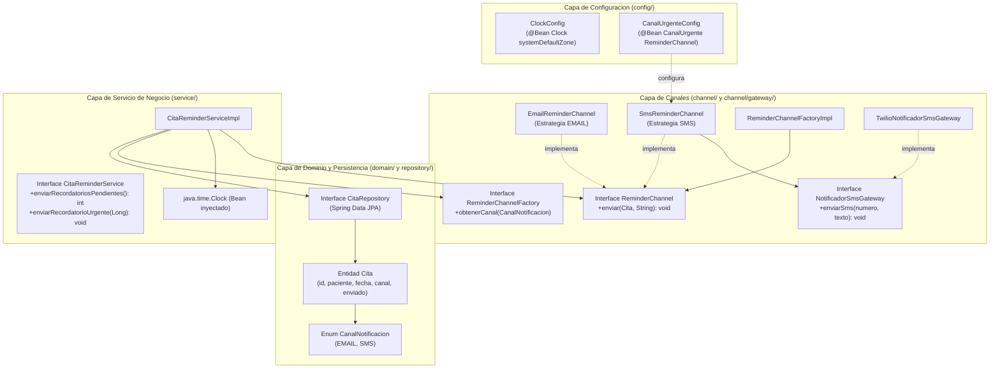
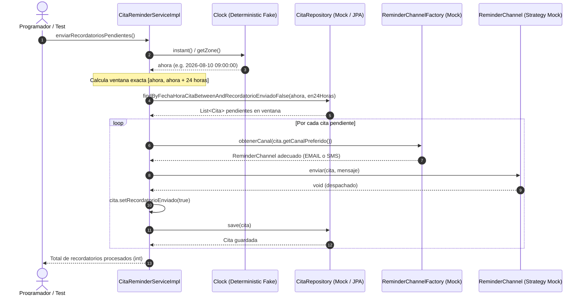
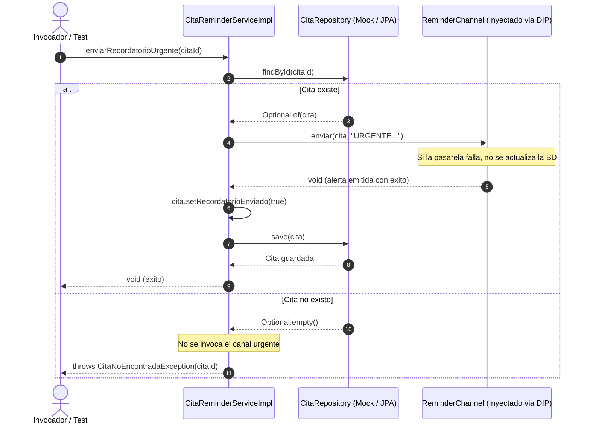

# Microservicio de Recordatorios de Citas Medicas (recordatorios-citas-service)

[](https://github.com/nicolaspalacio-bit/palacio-post1-u9/actions/workflows/ci.yml)

**Estudiante:** Nicolas Andres Palacio Boada  
**Programa:** Ingenieria de Sistemas  
**Institucion:** Universidad de Santander (UDES), Sede Cucuta  
**Asignatura:** Patrones de Diseno de Software  
**Docente:** Jonathan Rolando Rey Castillo  
**Unidad 9:** Probar el Diseno: JUnit 5, Mockito, Test Doubles e Integracion Continua  

---

## Tabla de Contenido

- [1. Descripcion General del Sistema](#1-descripcion-general-del-sistema)
- [2. Arquitectura de Software y Patrones de Diseno](#2-arquitectura-de-software-y-patrones-de-diseno)
  - [2.1 Diagrama de Componentes y Capas](#21-diagrama-de-componentes-y-capas)
  - [2.2 Diagramas de Secuencia](#22-diagramas-de-secuencia)
  - [2.3 Arbol de Directorios Comentado](#23-arbol-de-directorios-comentado)
- [3. Mapeo de Patrones de Diseno y Testabilidad](#3-mapeo-de-patrones-de-diseno-y-testabilidad)
- [4. Refactorizacion DIP: Paso 7 a Paso 8](#4-refactorizacion-dip-paso-7-a-paso-8)
- [5. Matriz de Test Doubles y Diseno de Pruebas](#5-matriz-de-test-doubles-y-diseno-de-pruebas)
- [6. Tabla de Contratos e Interfaces Publicas](#6-tabla-de-contratos-e-interfaces-publicas)
- [7. Decisiones de Diseno Arquitectonico (ADR)](#7-decisiones-de-diseno-arquitectonico-adr)
- [8. Guia de Ejecucion Paso a Paso](#8-guia-de-ejecucion-paso-a-paso)
- [9. Evidencias de Ejecucion y Pruebas Reales](#9-evidencias-de-ejecucion-y-pruebas-reales)
- [10. Pipeline de Integracion Continua (CI)](#10-pipeline-de-integracion-continua-ci)
- [11. Analisis de Trade-offs y Conclusiones](#11-analisis-de-trade-offs-y-conclusiones)

---

## 1. Descripcion General del Sistema

El proyecto `recordatorios-citas-service` es un microservicio de mision critica implementado en **Java 21 (LTS)** y **Spring Boot 3.3.4**, concebido para automatizar la gestion, despacho y registro de recordatorios a pacientes en el sector clinico y hospitalario.

El servicio aborda dos responsabilidades operativas centrales:
1. **Despacho periodico por lotes (`enviarRecordatoriosPendientes`):** Identifica todas las citas agendadas en la ventana de las proximas 24 horas que aun no hayan recibido notificacion, resuelve dinamicamente el canal preferido del paciente (EMAIL o SMS) y transmite el mensaje correspondiente, marcando la cita como notificada de forma idempotente en base de datos.
2. **Despacho prioritario de emergencia (`enviarRecordatorioUrgente`):** Emite una alerta inmediata para una cita especifica a traves de un canal garantizado de alta prioridad inyectado por constructor, gestionando de forma segura las excepciones de dominio ante citas inexistentes y protegiendo el estado ante fallos en la pasarela.

El diseno del servicio esta estrictamente fundamentado en principios de diseno limpio y orientacion a pruebas (Test-Driven Design), desacoplando la logica de negocio de la infraestructura mediante la aplicacion de Strategy, Factory Method, Dependency Inversion Principle (DIP) y la abstraccion determinista del reloj del sistema (`java.time.Clock`).

---

## 2. Arquitectura de Software y Patrones de Diseno

### 2.1 Diagrama de Componentes y Capas

El microservicio esta estructurado en capas bien delimitadas con dependencias unidireccionales:



### 2.2 Diagramas de Secuencia

#### Flujo 1: Despacho de Recordatorios Pendientes por Lote



#### Flujo 2: Despacho de Recordatorio Urgente



---

### 2.3 Arbol de Directorios Comentado

Alineado estrictamente con la estructura solicitada en la guia de la unidad:

```text
palacio-post1-u9/
|-- .github/
|   `-- workflows/
|       `-- ci.yml                   # Pipeline GitHub Actions (JDK 21, build y verificacion Maven)
|-- docs/
|   |-- adr/
|   |   |-- ADR-001.md               # Seleccion de Test Doubles (Mock vs Stub vs Fake)
|   |   |-- ADR-002.md               # Inversion de Dependencias y Composition Root para Canal Urgente
|   |   |-- ADR-003.md               # Reloj determinista (java.time.Clock Fake) vs Mocks estaticos
|   |   `-- ADR-004.md               # Estrategia de pruebas de integracion con H2 y @MockBean
|   |-- capturas/
|   |   |-- 01-mvn-clean-compile.png # Evidencia compilacion limpia con JDK 21 y agente JaCoCo
|   |   |-- 02-mvn-test-unitarias.png# Evidencia ejecucion de suite unitaria CitaReminderServiceImplTest
|   |   |-- 03-mvn-test-persistencia-h2.png # Evidencia pruebas de limites y persistencia en H2
|   |   |-- 04-mvn-test-integracion-springboot.png # Evidencia pruebas completas con @SpringBootTest
|   |   `-- 05-mvn-clean-verify-jacoco.png # Evidencia ciclo verify completo y reporte JaCoCo
|   `-- GUIA_DE_PRUEBAS.md           # Guia operativa detallada de ejecucion y aserciones
|-- src/
|   |-- main/
|   |   |-- java/
|   |   |   `-- com/clinica/recordatorios/
|   |   |       |-- channel/
|   |   |       |   |-- gateway/
|   |   |       |   |   |-- NotificadorSmsGateway.java      # Puerto para proveedor de telefonia SMS
|   |   |       |   |   `-- TwilioNotificadorSmsGateway.java # Adaptador concreto de SMS Gateway
|   |   |       |   |-- EmailReminderChannel.java           # Estrategia concreta de notificacion por EMAIL
|   |   |       |   |-- ReminderChannel.java                # Interfaz Strategy para canales de salida
|   |   |       |   |-- ReminderChannelFactory.java         # Interfaz Factory Method para resolucion de canal
|   |   |       |   |-- ReminderChannelFactoryImpl.java     # Implementacion del Factory Method
|   |   |       |   `-- SmsReminderChannel.java             # Estrategia concreta de notificacion por SMS
|   |   |       |-- config/
|   |   |       |   |-- CanalUrgenteConfig.java             # Composition Root: cablea bean de canal urgente
|   |   |       |   `-- ClockConfig.java                    # Proveedor de reloj del sistema como bean
|   |   |       |-- domain/
|   |   |       |   |-- CanalNotificacion.java              # Enum de canales admitidos: EMAIL, SMS
|   |   |       |   `-- Cita.java                           # Entidad JPA con atributos de cita medica
|   |   |       |-- repository/
|   |   |       |   `-- CitaRepository.java                 # Interfaz Spring Data JPA con consulta derivada
|   |   |       |-- service/
|   |   |       |   |-- CitaNoEncontradaException.java      # Excepcion de dominio ante cita inexistente
|   |   |       |   |-- CitaReminderService.java            # Contrato del servicio de recordatorios
|   |   |       |   `-- CitaReminderServiceImpl.java        # Implementacion desacoplada con Strategy y DIP
|   |   |       `-- RecordatoriosCitasServiceApplication.java # Clase principal Spring Boot
|   |   `-- resources/
|   |       `-- application.properties                      # Parametros de base de datos MySQL/H2 y logging
|   `-- test/
|       |-- java/
|       |   `-- com/clinica/recordatorios/
|       |       |-- channel/
|       |       |   |-- gateway/
|       |       |   |   `-- TwilioNotificadorSmsGatewayTest.java # Prueba unitaria del adaptador de gateway
|       |       |   |-- EmailReminderChannelTest.java       # Prueba unitaria de la estrategia EMAIL
|       |       |   |-- ReminderChannelFactoryImplTest.java # Pruebas del Factory Method y resolucion Strategy
|       |       |   `-- SmsReminderChannelTest.java         # Prueba unitaria de la estrategia SMS
|       |       |-- config/
|       |       |   `-- ClockConfigTest.java                # Prueba unitaria del bean de Clock
|       |       |-- repository/
|       |       |   `-- CitaRepositoryTest.java             # 6 pruebas de limites exactos y persistencia H2
|       |       |-- service/
|       |       |   `-- CitaReminderServiceImplTest.java    # 8 pruebas unitarias con Mockito y Clock Fake
|       |       |-- CitaReminderServiceIntegrationTest.java # 5 pruebas de integracion @SpringBootTest con H2
|       |       `-- RecordatoriosCitasServiceApplicationTest.java # Prueba de instanciacion raiz
|       `-- resources/
|           `-- application.properties                      # Configuracion H2 en memoria para pruebas
|-- .gitignore                                              # Exclusion de target/, temporales y binarios
|-- pom.xml                                                 # Definicion del proyecto Maven con Java 21
`-- README.md                                               # Documentacion tecnica integral del proyecto
```

---

## 3. Mapeo de Patrones de Diseno y Testabilidad

El diseno del servicio no adopta patrones de forma decorativa, sino como mecanismos esenciales para garantizar testabilidad aislada, determinista y mantenible:

| Patron de Diseno | Componente en el Codigo | Beneficio de Diseno | Como Facilita las Pruebas Automatizadas |
| :--- | :--- | :--- | :--- |
| **Strategy** | `ReminderChannel`, `EmailReminderChannel`, `SmsReminderChannel` | Desacopla la orquestacion de recordatorios de los detalles tecnicos de cada canal (protocolos de red, transporte SMTP, APIs HTTP de SMS). | Permite probar `CitaReminderServiceImpl` sustituyendo el canal por un Mock de `ReminderChannel`. En las pruebas unitarias no se realizan conexiones reales de red ni se requieren credenciales de pasarela. Ademas, permite evaluar `EmailReminderChannel` y `SmsReminderChannel` en pruebas unitarias atómicas totalmente aisladas. |
| **Factory Method** | `ReminderChannelFactory`, `ReminderChannelFactoryImpl` | Centraliza la resolucion de la estrategia de notificacion adecuada segun el enum `CanalNotificacion`. | En las pruebas de servicio, `ReminderChannelFactory` se sustituye por un Mock de Mockito. Esto permite: (1) comprobar que el servicio solicita a la fabrica el canal correspondiente a la preferencia del paciente (`verify(factory).obtenerCanal(...)`), (2) retornar un doble predeterminado para simular cualquier canal, y (3) certificar que ante ausencia de citas la fabrica jamas es invocada (`verifyNoInteractions(factory)`). |
| **Dependency Inversion (DIP)** | Inyeccion de `ReminderChannel canalUrgente` via constructor | Las clases de alto nivel dependen de abstracciones, no de implementaciones concretas. El cableado se externaliza al Composition Root (`CanalUrgenteConfig`). | **Habilita pruebas criticas:** Al eliminar el operador `new` dentro de `enviarRecordatorioUrgente`, la prueba unitaria puede inyectar un mock de `canalUrgente`. Esto hace posible simular una caida de la pasarela (`doThrow`) para verificar que la cita **no** se guarda como enviada, y probar citas inexistentes verificando que el canal nunca es invocado (`verifyNoInteractions`). |
| **Reloj Determinista (Fake Object)** | `java.time.Clock` inyectado en `CitaReminderServiceImpl` | Proporciona una fuente determinista y reproducible para el calculo del instante actual y la ventana de 24 horas. | Sustituye llamadas estaticas no deterministas a `LocalDateTime.now()`. Con `Clock.fixed(...)` se congela el tiempo a un instante exacto (`2026-08-10T09:00:00Z`), permitiendo verificar mediante `ArgumentCaptor` los limites exactos de la ventana (`2026-08-10T09:00:00` a `2026-08-11T09:00:00`) sin tests intermitentes (*flaky tests*) ni recurrir a `mockStatic`. |

---

## 4. Refactorizacion DIP: Paso 7 a Paso 8

Durante el desarrollo, el metodo `enviarRecordatorioUrgente` fue introducido inicialmente instanciando directamente su canal de salida con el operador `new` (Paso 7 del laboratorio). Esta decision violo el Principio de Inversion de Dependencias (DIP) y bloqueo la capacidad de probar la logica de negocio en aislamiento.

En el Paso 8, se aplico la refactorizacion a DIP trasladando la dependencia al constructor de la clase, delegando la resolucion concreta al Composition Root de Spring (`CanalUrgenteConfig`).

### Comparacion de Codigo (Diff Block)

```diff
--- src/main/java/com/clinica/recordatorios/service/CitaReminderServiceImpl.java (Paso 7: Acoplamiento Rigido con new)
+++ src/main/java/com/clinica/recordatorios/service/CitaReminderServiceImpl.java (Paso 8: Inversion de Dependencias)
@@ -14,14 +14,19 @@
     private final CitaRepository citaRepository;
     private final ReminderChannelFactory reminderChannelFactory;
     private final Clock clock;
+    private final ReminderChannel canalUrgente;
 
-    public CitaReminderServiceImpl(CitaRepository citaRepository, ReminderChannelFactory reminderChannelFactory, Clock clock) {
+    public CitaReminderServiceImpl(CitaRepository citaRepository, 
+                                  ReminderChannelFactory reminderChannelFactory, 
+                                  @Qualifier("canalUrgente") ReminderChannel canalUrgente,
+                                  Clock clock) {
         this.citaRepository = citaRepository;
         this.reminderChannelFactory = reminderChannelFactory;
+        this.canalUrgente = canalUrgente;
         this.clock = clock;
     }
 
     @Override
     public void enviarRecordatorioUrgente(Long citaId) {
         Cita cita = citaRepository.findById(citaId)
             .orElseThrow(() -> new CitaNoEncontradaException(citaId));
         
-        // Acoplamiento directo: Impide sustituir el canal en pruebas unitarias
-        ReminderChannel canalUrgente = new SmsReminderChannel(new TwilioNotificadorSmsGateway());
-        canalUrgente.enviar(cita, "URGENTE...");
+        // Inversion de Dependencias: Canal abstracto inyectado por constructor
+        canalUrgente.enviar(cita, "URGENTE: su cita es en menos de 2 horas y no ha sido confirmada");
         
         cita.setRecordatorioEnviado(true);
         citaRepository.save(cita);
     }
```

### Impacto en la Testabilidad

<details>
<summary>Desplegar analisis detallado del impacto del refactor</summary>

Antes de la refactorizacion (Paso 7):
1. **Imposibilidad de aislar la prueba:** Ejecutar `enviarRecordatorioUrgente` forzaba la creacion de `TwilioNotificadorSmsGateway`, intentando conexiones de red externas inexistentes durante el test.
2. **Imposibilidad de probar fallos:** No existia ningun punto de extension para simular que la pasarela fallaba, impidiendo verificar que la cita no debia guardarse como enviada ante un error.
3. **Imposibilidad de verificar citas inexistentes:** No se podia comprobar si el canal urgente era o no invocado cuando el ID no existia en base de datos.

Tras la refactorizacion (Paso 8):
1. Las pruebas unitarias inyectan un mock `@Mock private ReminderChannel canalUrgenteMock`, ejecutandose en milisegundos con cero dependencias de red.
2. Es posible simular fallos del canal con `doThrow(...)` y certificar formalmente que `verify(citaRepository, never()).save(any())` y que `assertFalse(cita.isRecordatorioEnviado())`.
3. Es posible validar que ante citas inexistentes el canal urgente no es invocado: `verifyNoInteractions(canalUrgenteMock)`.
4. El entorno productivo recibe de forma transparente el canal configurado a traves del bean `@Bean public ReminderChannel canalUrgente(...)` en `CanalUrgenteConfig`.

</details>

---

## 5. Matriz de Test Doubles y Diseno de Pruebas

En concordancia con el estandar clasico de Gerard Meszaros (*xUnit Test Patterns*) y las directrices de Martin Fowler, la suite de pruebas implementa rigurosamente la taxonomia de dobles de prueba segun el comportamiento real implementado:

| Componente Colaborador | Categoria de Double | Implementacion Concreta | Justificacion del Comportamiento Real en las Pruebas |
| :--- | :--- | :--- | :--- |
| **`CitaRepository`** | **Mock** | Mockito `@Mock private CitaRepository citaRepository` | Se programan sus respuestas indirectas con `when(...)` y se auditan exhaustivamente sus interacciones contractuales mediante `verify(repo).save(cita)`, `verify(repo, never()).save(any())` y captura de argumentos con `ArgumentCaptor`. |
| **`ReminderChannelFactory`** | **Mock** | Mockito `@Mock private ReminderChannelFactory reminderChannelFactory` | Se programa con `when(factory.obtenerCanal(...)).thenReturn(...)` y se audita su protocolo de interaccion: se verifica que se solicita el canal segun la preferencia del paciente (`verify(factory).obtenerCanal(EMAIL/SMS)`) y que no se interactua con la fabrica si no hay citas pendientes (`verifyNoInteractions(factory)`). |
| **`ReminderChannel`** | **Mock** | Mockito `@Mock private ReminderChannel reminderChannelMock` / `canalUrgenteMock` | Se utiliza para sustituir tanto el canal resuelto por la fabrica como el canal urgente inyectado, verificando que el metodo `enviar(...)` es invocado exactamente una vez con los parametros correctos (`verify(canal).enviar(...)`), o que nunca es invocado ante fallos previos (`verifyNoInteractions(canal)`). |
| **`Clock`** | **Fake** | `Clock.fixed(Instant.parse("2026-08-10T09:00:00Z"), ZoneId.of("UTC"))` | **NO se mockea con Mockito.** Es una implementacion real, completa y funcional provista por el JDK (`java.time.Clock`). Proporciona tiempo determinista y reproducible congelando el instante, eliminando cualquier variacion temporal sin recurrir a `mockStatic`. |
| **Base de Datos Relacional** | **Fake** | Motor de base de datos H2 en memoria (`jdbc:h2:mem:...`) | En las pruebas con `@DataJpaTest` y `@SpringBootTest`, H2 opera como un Fake de MySQL: ejecuta DDL y sentencias SQL relacionales completas en memoria con alta velocidad y sin servidores externos. |
| **`NotificadorSmsGateway`** | **Mock (MockBean)** | Spring Boot `@MockBean private NotificadorSmsGateway notificadorSmsGateway` | En la prueba de integracion `@SpringBootTest`, intercepta la llamada final de red hacia el proveedor telefonico, permitiendo certificar el despacho y simular fallos de infraestructura sin llamadas HTTP reales. |

---

## 6. Tabla de Contratos e Interfaces Publicas

### 6.1 Servicio de Aplicacion (`CitaReminderService`)

| Metodo | Parametros | Retorno | Excepciones | Descripcion Funcional |
| :--- | :--- | :--- | :--- | :--- |
| `enviarRecordatoriosPendientes` | Ninguno | `int` (conteo procesado) | `RuntimeException` si falla persistencia | Consulta citas no notificadas en ventana `[ahora, ahora + 24h]`, despacha por su canal preferido y actualiza la bandera `recordatorioEnviado = true`. |
| `enviarRecordatorioUrgente` | `Long citaId` | `void` | `CitaNoEncontradaException` si ID no existe | Despacha alerta inmediata por el canal urgente inyectado y actualiza la cita como notificada unicamente si el envio fue exitoso. |

### 6.2 Repositorio de Persistencia (`CitaRepository`)

| Metodo | Parametros | Tipo Retorno | Consulta / SQL Derivado |
| :--- | :--- | :--- | :--- |
| `findByFechaHoraCitaBetweenAndRecordatorioEnviadoFalse` | `LocalDateTime inicio`, `LocalDateTime fin` | `List<Cita>` | `SELECT c FROM Cita c WHERE c.fechaHoraCita BETWEEN :inicio AND :fin AND c.recordatorioEnviado = false` |
| `findById` | `Long id` | `Optional<Cita>` | Busqueda por clave primaria estandar JPA |
| `save` | `Cita cita` | `Cita` | Operacion de insercion o actualizacion (*merge*) en el contexto de persistencia |

### 6.3 Canales y Fabrica (`ReminderChannel`, `ReminderChannelFactory`)

| Componente | Metodo | Parametros | Comportamiento |
| :--- | :--- | :--- | :--- |
| `ReminderChannel` | `enviar` | `Cita cita`, `String mensaje` | Contrato polimorfico Strategy para la emision de la notificacion al destinatario. |
| `ReminderChannelFactory` | `obtenerCanal` | `CanalNotificacion canal` | Resuelve la estrategia adecuada (`EmailReminderChannel` o `SmsReminderChannel`). |
| `NotificadorSmsGateway` | `enviarSms` | `String numero`, `String texto` | Puerto de comunicacion hacia el proveedor externo de telefonia movil. |

---

## 7. Decisiones de Diseno Arquitectonico (ADR)

Toda decision de diseno relevante se encuentra formalmente documentada en la carpeta `docs/adr/`:

- [ADR-001: Seleccion y Taxonomia de Test Doubles en la Suite de Pruebas](docs/adr/ADR-001.md)  
  *Define el criterio para utilizar Mocks para colaboradores de interaccion (`CitaRepository`, `ReminderChannelFactory`, `ReminderChannel`), Fake para el reloj (`Clock.fixed`), y Fake para la persistencia (H2).*
- [ADR-002: Inversion de Dependencias y Composition Root para Canal Urgente](docs/adr/ADR-002.md)  
  *Documenta el desacoplamiento del operador `new` dentro de `enviarRecordatorioUrgente` y la centralizacion del cableado en `CanalUrgenteConfig`.*
- [ADR-003: Reloj Determinista (Clock Fake) vs Mocks Dinamicos Estaticos](docs/adr/ADR-003.md)  
  *Justifica la inyeccion de `java.time.Clock` para eliminar la fragilidad de `LocalDateTime.now()` y prescindir de `mockStatic`.*
- [ADR-004: Estrategia de Pruebas de Integracion con H2 Embebido y @MockBean](docs/adr/ADR-004.md)  
  *Establece la coexistencia de MySQL para produccion y H2 en memoria para pruebas continuas veloces sin dependencias de infraestructura.*

---

## 8. Guia de Ejecucion Paso a Paso

Para compilar, ejecutar las pruebas y generar los reportes de calidad en sistemas Windows utilizando PowerShell bajo OpenJDK 21:

```powershell
# 1. Posicionarse en el directorio del microservicio
Set-Location -Path "C:\Users\LENOVO\OneDrive\Documentos\Universidad_Patrones\palacio-post1-u9"

# 2. Configurar variable de entorno JDK 21 (si no es el default del sistema)
$env:JAVA_HOME = "C:\Program Files\Android\openjdk\jdk-21.0.8"
$env:Path = "$env:JAVA_HOME\bin;" + $env:Path

# 3. Compilacion limpia del proyecto
mvn clean compile

# 4. Ejecucion de pruebas unitarias de servicio (8 pruebas con Mockito y Clock Fake)
mvn test -Dtest=CitaReminderServiceImplTest

# 5. Ejecucion de pruebas de persistencia JPA con H2 (6 pruebas de limites exactos)
mvn test -Dtest=CitaRepositoryTest

# 6. Ejecucion de pruebas de integracion Spring Boot con H2 (5 pruebas completas)
mvn test -Dtest=CitaReminderServiceIntegrationTest

# 7. Ejecucion consolidada de todas las pruebas (26 pruebas automatizadas)
mvn test

# 8. Verificacion integral del ciclo de vida y generacion de reporte JaCoCo
mvn clean verify
```

---

## 9. Evidencias de Ejecucion y Pruebas Reales

Cada captura expuesta a continuacion proviene directamente de una ejecucion real y automatizada del microservicio en el entorno de desarrollo bajo OpenJDK 21, archivada en la carpeta `docs/capturas/`:

### Evidencia 01: Compilacion Limpia del Proyecto (`01-mvn-clean-compile.png`)
Demuestra la compilacion limpia de las clases fuente con Java 21 y la preparacion automatica del agente JaCoCo (`jacoco.exec`), finalizando con `BUILD SUCCESS`.


---

### Evidencia 02: Suite de Pruebas Unitarias de Negocio (`02-mvn-test-unitarias.png`)
Demuestra la ejecucion exitosa de las 8 pruebas unitarias en `CitaReminderServiceImplTest` (despacho EMAIL, despacho SMS, despacho mixto, limites exactos con ArgumentCaptor, ausencia de citas, recordatorio urgente, fallo en gateway urgente y cita inexistente), con 0 fallos y 0 errores.


---

### Evidencia 03: Pruebas de Persistencia y Limites en H2 (`03-mvn-test-persistencia-h2.png`)
Demuestra la ejecucion de las 6 pruebas de `CitaRepositoryTest` con `@DataJpaTest` sobre la base de datos relacional H2 en memoria, verificando el segundo inicial exacto (09:00:00), el segundo final exacto (24h despues), la exclusion previa (08:59:59), la exclusion posterior (09:00:01), el filtro de ya enviadas y la persistencia de la bandera.


---

### Evidencia 04: Pruebas de Integracion con Spring Boot (`04-mvn-test-integracion-springboot.png`)
Demuestra el levantamiento del contexto completo de Spring Boot en `CitaReminderServiceIntegrationTest` con `@SpringBootTest` y H2, verificando las 5 pruebas de integracion (lotes mixtos EMAIL/SMS, ausencia de citas, despacho urgente, proteccion de estado ante fallo en pasarela y excepcion ante ID desconocido) con gateway SMS simulado mediante `@MockBean`.


---

### Evidencia 05: Verificacion Completa y Reporte JaCoCo (`05-mvn-clean-verify-jacoco.png`)
Demuestra la ejecucion consolidada de las **26 pruebas automatizadas** del proyecto (0 fallos, 0 errores, 0 omitidas), empaquetado del artefacto `recordatorios-citas-service-0.0.1-SNAPSHOT.jar` y generacion del reporte JaCoCo con **97% de cobertura de instrucciones** y **100% de cobertura de ramas** (4 de 4 ramas cubiertas).


---

## 10. Pipeline de Integracion Continua (CI)

El proyecto cuenta con un flujo de trabajo automatizado configurado en `.github/workflows/ci.yml`.

### Caracteristicas del Pipeline

- **Desencadenadores:** Ejecucion automatica ante eventos `push` y `pull_request` sobre la rama principal `main`.
- **Entorno de Ejecucion:** Contenedor `ubuntu-latest`.
- **Version de Java:** Eclipse Temurin JDK 21.
- **Cache de Dependencias:** Gestion nativa de cache Maven en GitHub Actions para optimizar los tiempos de build.
- **Comando de Calidad:** `mvn -B verify --no-transfer-progress`, garantizando que ninguna integracion a la rama principal prospere si existen fallos en las 26 pruebas o errores de compilacion.
- **Verificacion en Verde:** El pipeline se ejecuta de forma reproducible en cada commit hacia el repositorio remoto.

---

## 11. Analisis de Trade-offs y Conclusiones

### Balance Tecnico y Trade-offs de Diseno

1. **Inyeccion de `Clock` vs. Conveniencia de `LocalDateTime.now()`:**  
   *Trade-off:* Requiere inyectar una dependencia adicional en los servicios y definir un bean en la configuracion (`ClockConfig`).  
   *Beneficio:* Otorga 100% de determinismo en las pruebas de tiempo. Evita el uso de `mockStatic` de Mockito, el cual consume mas memoria y ralentiza la ejecucion en pipelines de CI.
2. **Strategy + Factory Method vs. Bloques Condicionales Simples:**  
   *Trade-off:* Incrementa el numero de clases e interfaces en el proyecto.  
   *Beneficio:* Cumple el principio Abierto/Cerrado (OCP). Incorporar un nuevo canal de notificacion requiere unicamente agregar una nueva clase que implemente `ReminderChannel` y registrarla en el factory, sin alterar el servicio de citas existente ni romper su cobertura de pruebas.
3. **Refactor DIP para `enviarRecordatorioUrgente`:**  
   *Trade-off:* El Composition Root (`CanalUrgenteConfig`) debe cablear explicitamente la implementacion del canal urgente.  
   *Beneficio:* Elimina por completo el acoplamiento directo a implementaciones concretas de red (`TwilioNotificadorSmsGateway`), permitiendo simular fallos de pasarela y garantizando que la cita no se marque como enviada si el despacho no fue exitoso.

### Conclusiones

El microservicio `recordatorios-citas-service` demuestra que el diseno de software y la testabilidad no son objetivos independientes, sino fuerzas simbioticas: **un codigo bien disenado bajo principios SOLID es inherentemente facil de probar, mientras que la dificultad para escribir una prueba unitaria senala de forma inmediata un defecto en el diseno arquitectonico.**