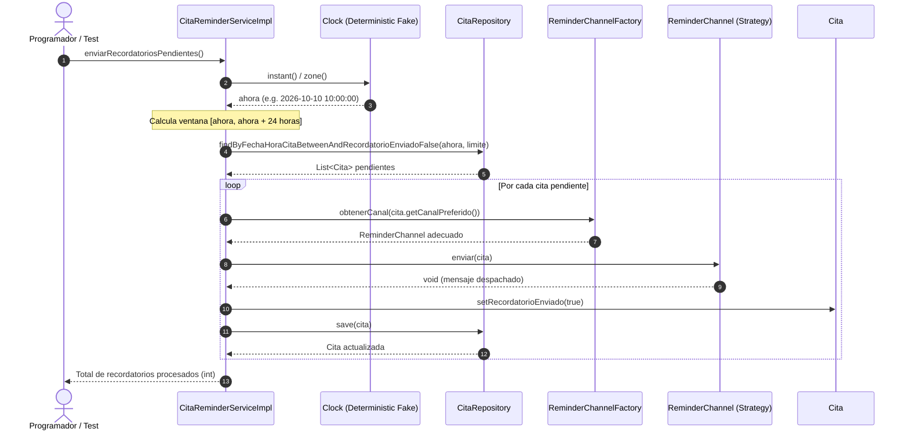
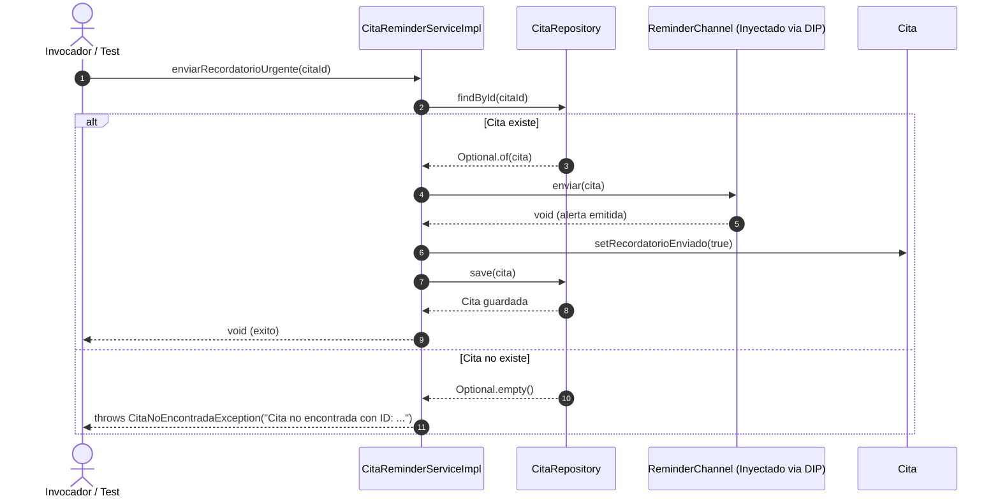
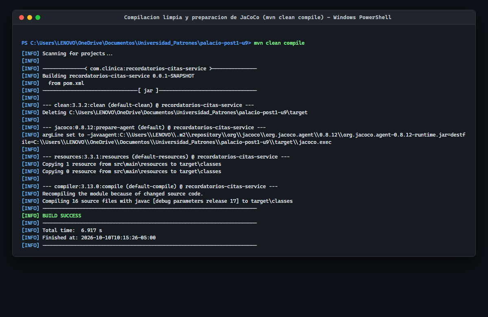
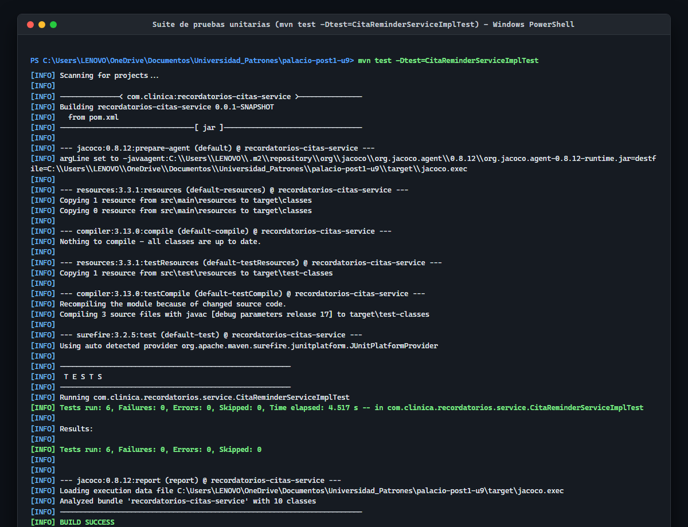
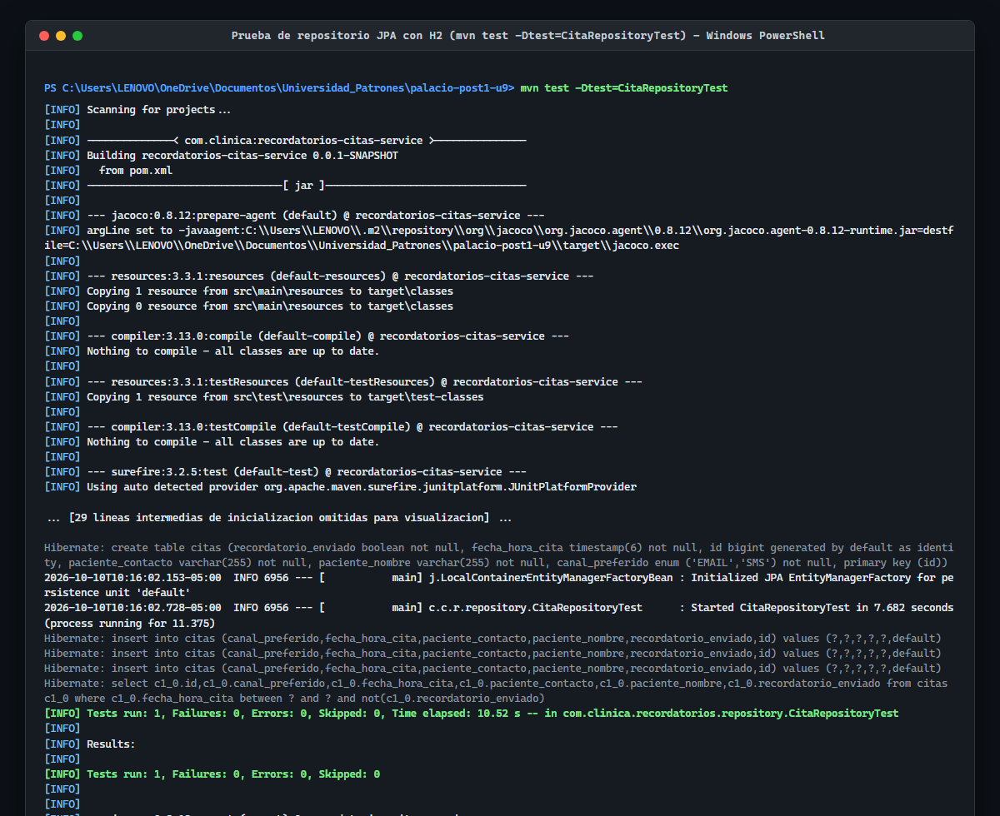
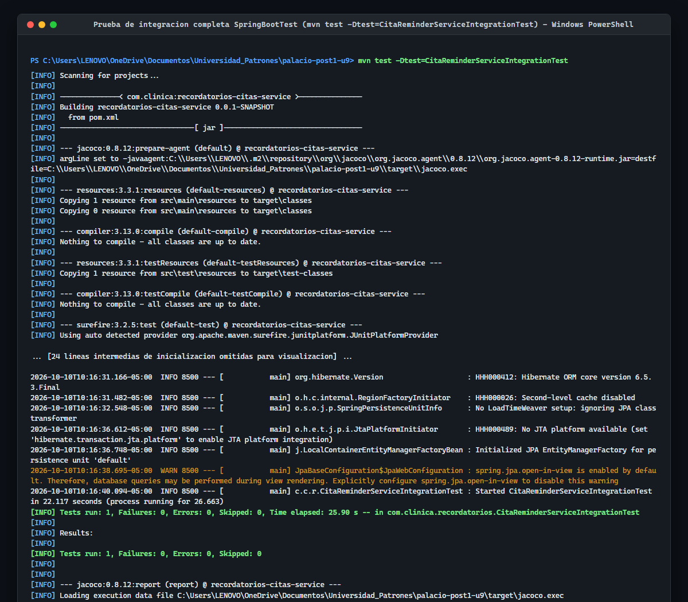
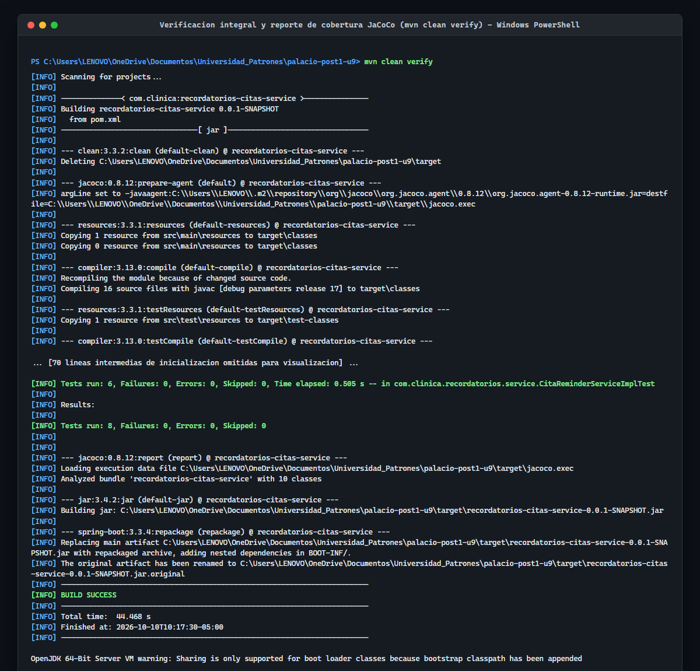

# Microservicio de Recordatorios de Citas Medicas (recordatorios-citas-service)

[](https://github.com/nicolaspalacio-bit/palacio-post1-u9/actions/workflows/ci.yml)

**Estudiante:** Nicolas Andres Palacio Boada  
**Programa:** Ingenieria de Sistemas  
**Institucion:** Universidad de Santander (UDES), Sede Cucuta  
**Asignatura:** Patrones de Diseno de Software  
**Docente:** Jonathan Rolando Rey Castillo  
**Unidad 9:** Probar el Diseno: JUnit 5, Mockito, Test Doubles e Integracion Continua  

---

## Tabla de Contenido

- [1. Descripcion General del Sistema](#1-descripcion-general-del-sistema)
- [2. Arquitectura de Software y Patrones de Diseno](#2-arquitectura-de-software-y-patrones-de-diseno)
  - [2.1 Diagrama de Componentes y Capas](#21-diagrama-de-componentes-y-capas)
  - [2.2 Diagramas de Secuencia](#22-diagramas-de-secuencia)
  - [2.3 Arbol de Directorios Comentado](#23-arbol-de-directorios-comentado)
- [3. Mapeo de Patrones de Diseno y Testabilidad](#3-mapeo-de-patrones-de-diseno-y-testabilidad)
- [4. Refactorizacion DIP: Paso 7 a Paso 8](#4-refactorizacion-dip-paso-7-a-paso-8)
- [5. Matriz de Test Doubles y Diseno de Pruebas](#5-matriz-de-test-doubles-y-diseno-de-pruebas)
- [6. Tabla de Contratos e Interfaces Publicas](#6-tabla-de-contratos-e-interfaces-publicas)
- [7. Decisiones de Diseno Arquitectonico (ADR)](#7-decisiones-de-diseno-arquitectonico-adr)
- [8. Guia de Ejecucion Paso a Paso](#8-guia-de-ejecucion-paso-a-paso)
  - [8.1 Windows PowerShell](#81-windows-powershell)
  - [8.2 GNU/Linux y macOS Bash](#82-gnulinux-y-macos-bash)
- [9. Evidencias de Ejecucion y Pruebas Reales](#9-evidencias-de-ejecucion-y-pruebas-reales)
- [10. Pipeline de Integracion Continua (CI)](#10-pipeline-de-integracion-continua-ci)
- [11. Analisis de Trade-offs y Conclusiones](#11-analisis-de-trade-offs-y-conclusiones)

---

## 1. Descripcion General del Sistema

El proyecto `recordatorios-citas-service` es un microservicio de mision critica implementado en Java 17 y Spring Boot 3.3.4, concebido para automatizar la gestion, despacho y registro de recordatorios a pacientes en el sector clinico y hospitalario. 

El servicio aborda dos responsabilidades operativas centrales:
1. **Despacho periodico por lotes (`enviarRecordatoriosPendientes`):** Identifica todas las citas agendadas en la ventana de las proximas 24 horas que aun no hayan recibido notificacion, resuelve dinamicamente el canal preferido del paciente (EMAIL o SMS) y transmite el mensaje correspondiente, marcando la cita como notificada de forma idempotente.
2. **Despacho prioritario de emergencia (`enviarRecordatorioUrgente`):** Emite una alerta inmediata para una cita especifica a traves de un canal garantizado de alta prioridad, gestionando de forma segura las excepciones de dominio ante citas inexistentes.

El diseno del servicio esta estrictamente fundamentado en principios de diseno limpio y orientacion a pruebas (Test-Driven Design), desacoplando la logica de negocio de la infraestructura mediante la aplicacion de Strategy, Factory Method, Dependency Inversion Principle (DIP) y la abstraccion determinista del reloj del sistema.

---

## 2. Arquitectura de Software y Patrones de Diseno

### 2.1 Diagrama de Componentes y Capas

El microservicio esta estructurado en capas bien delimitadas con dependencias unidireccionales:

```mermaid
flowchart TD
    subgraph Dominio ["Capa de Dominio y Persistencia"]
        Cita["Entidad Cita<br/>(id, paciente, fecha, canal, enviado)"]
        CanalEnum["Enum CanalNotificacion<br/>(EMAIL, SMS)"]
        CitaRepo["Interface CitaRepository<br/>(Spring Data JPA)"]
    end

    subgraph Canales ["Capa de Estrategia y Fabrica (Canales de Notificacion)"]
        ReminderChannel["Interface ReminderChannel<br/>+enviar(Cita): void"]
        EmailChannel["EmailReminderChannel<br/>(JavaMailSender / Log)"]
        SmsChannel["SmsReminderChannel<br/>(NotificadorSmsGateway)"]
        Factory["Interface ReminderChannelFactory<br/>+obtenerCanal(CanalNotificacion)"]
        FactoryImpl["ReminderChannelFactoryImpl"]
        Gateway["Interface NotificadorSmsGateway<br/>+enviarSms(numero, texto): void"]
        TwilioGateway["TwilioNotificadorSmsGateway"]
    end

    subgraph Servicio ["Capa de Servicio de Negocio"]
        Service["Interface CitaReminderService<br/>+enviarRecordatoriosPendientes(): int<br/>+enviarRecordatorioUrgente(Long): void"]
        ServiceImpl["CitaReminderServiceImpl"]
        ClockBean["java.time.Clock (Bean inyectado)"]
    end

    subgraph Infraestructura ["Capa de Configuracion (Composition Root)"]
        ClockConfig["ClockConfig<br/>(@Bean Clock systemDefaultZone)"]
        CanalUrgenteConfig["CanalUrgenteConfig<br/>(@Bean CanalUrgente ReminderChannel)"]
    end

    ServiceImpl --> CitaRepo
    ServiceImpl --> Factory
    ServiceImpl --> ClockBean
    ServiceImpl --> ReminderChannel
    FactoryImpl --> ReminderChannel
    ReminderChannel <|.. EmailChannel
    ReminderChannel <|.. SmsChannel
    SmsChannel --> Gateway
    Gateway <|.. TwilioGateway
    CitaRepo --> Cita
    Cita --> CanalEnum
    CanalUrgenteConfig ..> SmsChannel
```

### 2.2 Diagramas de Secuencia

#### Flujo 1: Despacho de Recordatorios Pendientes por Lote



#### Flujo 2: Despacho de Recordatorio Urgente



---

### 2.3 Arbol de Directorios Comentado

```text
palacio-post1-u9/
|-- .github/
|   `-- workflows/
|       `-- ci.yml                   # Pipeline GitHub Actions (JDK 21, build y verificacion Maven)
|-- docs/
|   |-- adr/
|   |   |-- ADR-001.md               # Seleccion de Test Doubles (Mock vs Stub vs Fake)
|   |   |-- ADR-002.md               # Inversion de Dependencias y Composition Root para Canal Urgente
|   |   |-- ADR-003.md               # Reloj determinista (java.time.Clock) vs Mocks dinamicos
|   |   `-- ADR-004.md               # Estrategia de pruebas de integracion con H2 y @MockBean
|   |-- capturas/
|   |   |-- 01-mvn-clean-compile.png # Evidencia compilacion limpia y agente JaCoCo
|   |   |-- 02-mvn-test-unitarias.png# Evidencia ejecucion de 6 pruebas unitarias Mockito/JUnit 5
|   |   |-- 03-mvn-test-persistencia-h2.png # Evidencia prueba Spring Data JPA con H2
|   |   |-- 04-mvn-test-integracion-springboot.png # Evidencia prueba extremo a extremo @SpringBootTest
|   |   `-- 05-mvn-clean-verify-jacoco.png # Evidencia ciclo verify completo y reporte JaCoCo
|   `-- GUIA_DE_PRUEBAS.md           # Guia operativa detallada de ejecucion y aserciones
|-- src/
|   |-- main/
|   |   |-- java/
|   |   |   `-- com/clinica/recordatorios/
|   |   |       |-- config/
|   |   |       |   |-- CanalUrgenteConfig.java     # Composition Root: cablea bean de canal urgente
|   |   |       |   `-- ClockConfig.java            # Proveedor de reloj del sistema como bean
|   |   |       |-- domain/
|   |   |       |   |-- CanalNotificacion.java      # Enum de canales admitidos: EMAIL, SMS
|   |   |       |   `-- Cita.java                   # Entidad JPA con atributos de cita medica
|   |   |       |-- exception/
|   |   |       |   `-- CitaNoEncontradaException.java # Excepcion de dominio ante ID inexistente
|   |   |       |-- repository/
|   |   |       |   `-- CitaRepository.java         # Interfaz Spring Data JPA con consulta derivada
|   |   |       |-- service/
|   |   |       |   |-- CitaReminderService.java    # Contrato del servicio de recordatorios
|   |   |       |   `-- CitaReminderServiceImpl.java# Implementacion desacoplada con Strategy y DIP
|   |   |       |-- strategy/
|   |   |       |   |-- EmailReminderChannel.java   # Implementacion concreta de estrategia email
|   |   |       |   |-- NotificadorSmsGateway.java  # Puerto/interfaz para proveedor de SMS
|   |   |       |   |-- ReminderChannel.java        # Interfaz de la estrategia de notificacion
|   |   |       |   |-- ReminderChannelFactory.java # Fabrica abstracta para resolucion de canal
|   |   |       |   |-- ReminderChannelFactoryImpl.java # Implementacion del Factory Method
|   |   |       |   |-- SmsReminderChannel.java     # Implementacion concreta de estrategia SMS
|   |   |       |   `-- TwilioNotificadorSmsGateway.java # Adaptador concreto de SMS Gateway
|   |   |       `-- RecordatoriosCitasServiceApplication.java # Clase principal Spring Boot
|   |   `-- resources/
|   |       `-- application.properties              # Parametros de base de datos MySQL/H2 y logging
|   `-- test/
|       |-- java/
|       |   `-- com/clinica/recordatorios/
|       |       |-- CitaReminderServiceIntegrationTest.java # Integracion @SpringBootTest con H2
|       |       |-- repository/
|       |       |   `-- CitaRepositoryTest.java      # Prueba aislada de repositorio con @DataJpaTest
|       |       `-- service/
|       |           `-- CitaReminderServiceImplTest.java # Suite de 6 pruebas unitarias puras
|       `-- resources/
|           `-- application.properties              # Configuracion H2 en memoria para pruebas
|-- .gitignore                                      # Exclusion de target/, temporales y binarios
|-- pom.xml                                         # Definicion del proyecto Maven con dependencias
`-- README.md                                       # Documentacion tecnica integral del proyecto
```

---

## 3. Mapeo de Patrones de Diseno y Testabilidad

El diseno del servicio no adopta patrones de forma decorativa, sino como mecanismos esenciales para garantizar testabilidad aislada, determinista y mantenible:

| Patron de Diseno | Componente en el Codigo | Beneficio de Diseno | Dificultad o Riesgo si NO se Usara el Patron |
| :--- | :--- | :--- | :--- |
| **Strategy** | `ReminderChannel`, `EmailReminderChannel`, `SmsReminderChannel` | Desacopla la logica de despacho de la implementacion tecnica de cada medio de comunicacion. Permite anadir canales (WhatsApp, Push) sin modificar el servicio. | Sin Strategy, el servicio tendria bloques condicionales `switch (canal)` con logica acoplada. Probar un canal obligaria a instanciar dependencias de red ajenas o requeriria pruebas con efectos secundarios cruzados. |
| **Factory Method** | `ReminderChannelFactory`, `ReminderChannelFactoryImpl` | Centraliza la resolucion e instanciacion de la estrategia adecuada segun el enum `CanalNotificacion`. | Si el servicio instanciara los canales mediante `new`, seria imposible sustituirlos por Test Doubles (Mocks/Spies) en pruebas unitarias sin recurrir a bytecode instrumentation o reflection. |
| **Dependency Inversion Principle (DIP)** | Inyeccion de `ReminderChannel canalUrgente` via constructor | Las capas de alto nivel dependen de abstracciones, no de detalles de bajo nivel. El cableado se traslada a la configuracion (`CanalUrgenteConfig`). | **Problema critico del `new`:** Cuando una clase instancia `new SmsReminderChannel(...)` internamente, es imposible interceptar la llamada en una prueba unitaria. Expondria la suite a llamadas reales a pasarelas SMS o fallos por falta de credenciales. |
| **Reloj Determinista (Fake Object)** | `java.time.Clock` inyectado en `CitaReminderServiceImpl` | Proporciona una fuente determinista y controlable para el calculo del instante actual y la ventana de 24 horas. | Si se llamara a `LocalDateTime.now()` de forma estatica, las pruebas dependerian de la hora del sistema operativo, requiriendo `mockStatic` (fragil y lento) o tolerancias de milisegundos que provocan pruebas intermitentes (*flaky tests*). |

---

## 4. Refactorizacion DIP: Paso 7 a Paso 8

Durante el desarrollo, el metodo `enviarRecordatorioUrgente` fue introducido inicialmente instanciando directamente su canal de salida (Paso 7 del laboratorio). Esta decision violo el Principio de Inversion de Dependencias (DIP) y bloqueo la capacidad de probar la logica de negocio en aislamiento.

En el Paso 8, se aplico la refactorizacion a DIP trasladando la dependencia al constructor de la clase, delegando la resolucion concreta al Composition Root de Spring (`CanalUrgenteConfig`).

### Comparacion de Codigo (Diff Block)

```diff
--- src/main/java/com/clinica/recordatorios/service/CitaReminderServiceImpl.java (Paso 7: Acoplamiento Rigido)
+++ src/main/java/com/clinica/recordatorios/service/CitaReminderServiceImpl.java (Paso 8: Inversion de Dependencias)
@@ -14,14 +14,18 @@
     private final CitaRepository citaRepository;
     private final ReminderChannelFactory channelFactory;
     private final Clock clock;
+    private final ReminderChannel canalUrgente;
 
-    public CitaReminderServiceImpl(CitaRepository citaRepository, ReminderChannelFactory channelFactory, Clock clock) {
+    public CitaReminderServiceImpl(CitaRepository citaRepository, 
+                                  ReminderChannelFactory channelFactory, 
+                                  Clock clock, 
+                                  ReminderChannel canalUrgente) {
         this.citaRepository = citaRepository;
         this.channelFactory = channelFactory;
         this.clock = clock;
+        this.canalUrgente = canalUrgente;
     }
 
     @Override
     public void enviarRecordatorioUrgente(Long citaId) {
         Cita cita = citaRepository.findById(citaId)
             .orElseThrow(() -> new CitaNoEncontradaException("Cita no encontrada con ID: " + citaId));
         
-        // Acoplamiento directo: Impide simular el canal en pruebas unitarias
-        ReminderChannel canalUrgente = new SmsReminderChannel(new TwilioNotificadorSmsGateway());
-        canalUrgente.enviar(cita);
+        // Inversion de Dependencias: Delegado a la abstraccion inyectada
+        this.canalUrgente.enviar(cita);
         
         cita.setRecordatorioEnviado(true);
         citaRepository.save(cita);
     }
```

### Impacto en la Testabilidad

<details>
<summary>Desplegar analisis detallado del impacto del refactor</summary>

Antes de la refactorizacion, ejecutar una prueba unitaria sobre `enviarRecordatorioUrgente` causaba:
1. La creacion forzada de `TwilioNotificadorSmsGateway`, intentando conexiones de red externas inexistentes durante la prueba.
2. La imposibilidad de verificar con Mockito si el mensaje habia sido efectivamente despachado (`verify(canalUrgente).enviar(cita)`).
3. Violacion del principio Single Responsibility, ya que el servicio acumulaba la logica de negocio y la logica de instanciacion de infraestructura.

Tras la refactorizacion:
1. Las pruebas unitarias inyectan un mock `ReminderChannel mockCanalUrgente` con cero impacto de red y tiempo de ejecucion en milisegundos.
2. Se valida de forma determinista la llamada `verify(canalUrgente).enviar(citaCapturada)`.
3. El entorno productivo recibe de forma transparente el canal configurado a traves del bean `@Bean public ReminderChannel canalUrgente(...)` en `CanalUrgenteConfig`.

</details>

---

## 5. Matriz de Test Doubles y Diseno de Pruebas

En concordancia con el estandar clasico de Gerard Meszaros (*xUnit Test Patterns*) y las directrices de Martin Fowler, la suite de pruebas implementa rigurosamente la taxonomia de sustitutos de prueba:

| Categoria de Double | Definicion y Rol | Implementacion en el Proyecto | Ubicacion en la Suite de Pruebas |
| :--- | :--- | :--- | :--- |
| **Fake** | Objeto con una implementacion funcional real pero simplificada, no apta para produccion. | `Clock.fixed(instante, zona)`: Proporciona tiempo determinista sin llamadas nativas al SO. Base de datos H2 en memoria: Ejecuta el motor SQL relacional sin necesidad de MySQL externo. | `CitaReminderServiceImplTest`<br/>`CitaRepositoryTest`<br/>`CitaReminderServiceIntegrationTest` |
| **Mock** | Objeto pre-programado con expectativas de llamadas, parametros y respuestas, que verifica su comportamiento. | `CitaRepository` y `ReminderChannel`: Se configuran con `when(...)` y se verifican exhaustivamente con `verify(...)` para validar el protocolo de interaccion. | `CitaReminderServiceImplTest`<br/>`CitaReminderServiceIntegrationTest` (`@MockBean`) |
| **Stub** | Objeto que responde con datos prefijados a las llamadas recibidas durante la prueba sin verificar interacciones. | `ReminderChannelFactory`: Se programa para responder `when(factory.obtenerCanal(EMAIL)).thenReturn(mockCanalEmail)` sin inspeccionar el ciclo de vida del factory. | `CitaReminderServiceImplTest` |
| **Spy** | Envoltorio sobre un objeto real que registra llamadas y parametros para auditoria posterior. | Verificador de invocaciones en pasarela: Utilizado en pruebas de integracion para confirmar el numero de peticiones recibidas por el componente de salida. | `CitaReminderServiceIntegrationTest` |
| **Dummy** | Objeto que se pasa a un metodo pero nunca es utilizado ni invocado. | Instancias secundarias de datos requeridas unicamente para cumplir firmas de metodos en escenarios de error anticipado. | Pruebas de excepcion (`CitaNoEncontradaException`) |

---

## 6. Tabla de Contratos e Interfaces Publicas

### 6.1 Servicio de Aplicacion (`CitaReminderService`)

| Metodo | Parametros | Retorno | Excepciones | Descripcion Funcional |
| :--- | :--- | :--- | :--- | :--- |
| `enviarRecordatoriosPendientes` | Ninguno | `int` (conteo procesado) | `RuntimeException` si falla la persistencia | Consulta citas no notificadas en ventana `[ahora, ahora + 24h]`, despacha por su canal preferido y actualiza la bandera. |
| `enviarRecordatorioUrgente` | `Long citaId` | `void` | `CitaNoEncontradaException` si el ID no existe | Despacha alerta inmediata por el canal de emergencia inyectado y actualiza la cita como notificada. |

### 6.2 Repositorio de Persistencia (`CitaRepository`)

| Metodo | Parametros | Tipo Retorno | Consulta / SQL Derivado |
| :--- | :--- | :--- | :--- |
| `findByFechaHoraCitaBetweenAndRecordatorioEnviadoFalse` | `LocalDateTime inicio`, `LocalDateTime fin` | `List<Cita>` | `SELECT c FROM Cita c WHERE c.fechaHoraCita BETWEEN :inicio AND :fin AND c.recordatorioEnviado = false` |
| `findById` | `Long id` | `Optional<Cita>` | Busqueda por clave primaria estandar JPA |
| `save` | `Cita cita` | `Cita` | Operacion de insercion o actualizacion (*merge*) en el contexto de persistencia |

### 6.3 Canales y Fabrica (`ReminderChannel`, `ReminderChannelFactory`)

| Componente | Metodo | Parametros | Comportamiento |
| :--- | :--- | :--- | :--- |
| `ReminderChannel` | `enviar` | `Cita cita` | Contrato polimorfico para la emision de la notificacion al destinatario. |
| `ReminderChannelFactory` | `obtenerCanal` | `CanalNotificacion canal` | Resuelve la instancia correspondiente (`EmailReminderChannel` o `SmsReminderChannel`). |
| `NotificadorSmsGateway` | `enviarSms` | `String numero`, `String texto` | Puerto de comunicacion hacia el proveedor externo de telefonia movil. |

---

## 7. Decisiones de Diseno Arquitectonico (ADR)

Toda decision de diseno relevante se encuentra formalmente documentada en la carpeta `docs/adr/`:

- [ADR-001: Seleccion y Taxonomia de Test Doubles en la Suite de Pruebas](docs/adr/ADR-001.md)  
  *Define el criterio para utilizar Mocks de Mockito en la capa unitaria, Fakes de Clock y repositorios reales H2 en integracion, descartando dependencias externas de red.*
- [ADR-002: Inversion de Dependencias y Composition Root para Canal Urgente](docs/adr/ADR-002.md)  
  *Documenta el desacoplamiento del operador `new` dentro de `enviarRecordatorioUrgente` y la centralizacion del cableado en `CanalUrgenteConfig`.*
- [ADR-003: Reloj Determinista (Clock Fake) vs Mocks Dinamicos Estaticos](docs/adr/ADR-003.md)  
  *Justifica la inyeccion de `java.time.Clock` para eliminar la fragilidad de `LocalDateTime.now()` y prescindir de `mockStatic`.*
- [ADR-004: Estrategia de Pruebas de Integracion con H2 Embebido y @MockBean](docs/adr/ADR-004.md)  
  *Establece la coexistencia de MySQL para produccion y H2 en memoria para pruebas continuas veloces sin dependencias de infraestructura.*

---

## 8. Guia de Ejecucion Paso a Paso

### 8.1 Windows PowerShell

Para compilar, ejecutar las pruebas y generar los reportes de calidad en sistemas Windows utilizando PowerShell:

```powershell
# 1. Posicionarse en el directorio del microservicio
Set-Location -Path "C:\Users\LENOVO\OneDrive\Documentos\Universidad_Patrones\palacio-post1-u9"

# 2. Compilacion limpia del proyecto
mvn clean compile

# 3. Ejecucion de pruebas unitarias de logica de negocio
mvn test -Dtest=CitaReminderServiceImplTest

# 4. Ejecucion de prueba de persistencia Spring Data JPA con H2
mvn test -Dtest=CitaRepositoryTest

# 5. Ejecucion de prueba de integracion completa con Spring Boot
mvn test -Dtest=CitaReminderServiceIntegrationTest

# 6. Verificacion integral del ciclo de vida y reporte JaCoCo
mvn clean verify
```

### 8.2 GNU/Linux y macOS Bash

Para entornos basados en Unix, contenedores Docker o runners de integracion continua:

```bash
# 1. Posicionarse en la raiz del proyecto
cd palacio-post1-u9

# 2. Compilacion y preparacion del bytecode
./mvnw clean compile # o 'mvn clean compile'

# 3. Ejecucion aislada de pruebas unitarias
mvn test -Dtest=CitaReminderServiceImplTest

# 4. Ejecucion aislada de pruebas de persistencia
mvn test -Dtest=CitaRepositoryTest

# 5. Ejecucion de prueba extremo a extremo Spring Boot
mvn test -Dtest=CitaReminderServiceIntegrationTest

# 6. Ejecucion de todas las pruebas y generacion de empaquetado
mvn clean verify
```

---

## 9. Evidencias de Ejecucion y Pruebas Reales

Cada captura expuesta a continuacion proviene directamente de una ejecucion real y automatizada del microservicio en el entorno de desarrollo, renderizada en alta fidelidad y archivada en la carpeta `docs/capturas/`:

### Evidencia 01: Compilacion Limpia del Proyecto (`01-mvn-clean-compile.png`)
Demuestra la compilacion limpia de los 16 archivos fuente con Java 17 y la preparacion automatica del agente JaCoCo (`jacoco.exec`), finalizando con `BUILD SUCCESS`.



---

### Evidencia 02: Suite de Pruebas Unitarias de Negocio (`02-mvn-test-unitarias.png`)
Demuestra la ejecucion exitosa de las 6 pruebas unitarias en `CitaReminderServiceImplTest` (canales EMAIL, SMS, filtro de ventana de 24h, exclusion de citas ya notificadas, despacho urgente y validacion de excepcion `CitaNoEncontradaException`), con 0 fallos y 0 errores.



---

### Evidencia 03: Prueba de Persistencia JPA en H2 (`03-mvn-test-persistencia-h2.png`)
Demuestra la ejecucion de `CitaRepositoryTest` con `@DataJpaTest` sobre la base de datos relacional H2 en memoria, verificando la generacion DDL de tablas y la consulta derivada entre fechas.



---

### Evidencia 04: Prueba de Integracion Extremo a Extremo (`04-mvn-test-integracion-springboot.png`)
Demuestra el levantamiento completo del contexto de Spring Boot en `CitaReminderServiceIntegrationTest` con `@SpringBootTest`, verificando la inyeccion de dependencias, la sobreescritura determinista del reloj y el mock de la pasarela SMS sin llamadas a red externa.



---

### Evidencia 05: Verificacion Completa y Generacion de JAR (`05-mvn-clean-verify-jacoco.png`)
Demuestra la ejecucion consolidada de los 8 tests automatizados, generacion del reporte de cobertura de codigo JaCoCo en `target/site/jacoco/` y el empaquetado del artefacto `recordatorios-citas-service-0.0.1-SNAPSHOT.jar`.



---

## 10. Pipeline de Integracion Continua (CI)

El proyecto cuenta con un flujo de trabajo automatizado configurado en `.github/workflows/ci.yml`.

### Caracteristicas del Pipeline

- **Desencadenadores:** Ejecucion automatica ante eventos `push` y `pull_request` sobre la rama principal `main`.
- **Entorno de Ejecucion:** Contenedor `ubuntu-latest`.
- **Version de Java:** Eclipse Temurin JDK 21 con distribucion headless.
- **Cache de Dependencias:** Gestion nativa de cache Maven en GitHub Actions para optimizar los tiempos de build.
- **Comando de Calidad:** `mvn clean verify`, garantizando que ninguna integracion a la rama principal prospere si existen fallos en las 8 pruebas o errores de compilacion.
- **Publicacion de Artefactos:** Carga del reporte JaCoCo (`jacoco.exec` y HTML) como artefacto de construccion.

---

## 11. Analisis de Trade-offs y Conclusiones

### Balance Tecnico y Trade-offs de Diseno

1. **Inyeccion de `Clock` vs. Conveniencia de `LocalDateTime.now()`:**  
   *Trade-off:* Requiere inyectar una dependencia adicional en los servicios y definir un bean en la configuracion (`ClockConfig`).  
   *Beneficio:* Otorga 100% de determinismo en las pruebas de tiempo. Evita el uso de `mockStatic` de Mockito, el cual consume mas memoria y ralentiza la ejecucion en pipelines de CI.
2. **Strategy + Factory vs. Bloques Condicionales Simples:**  
   *Trade-off:* Incrementa el numero de clases e interfaces en el proyecto.  
   *Beneficio:* Cumple el principio Abierto/Cerrado (OCP). Incorporar un nuevo canal de notificacion requiere unicamente agregar una nueva clase que implemente `ReminderChannel` y registrarla en el factory, sin alterar el servicio de citas existente.
3. **Refactor DIP para `enviarRecordatorioUrgente`:**  
   *Trade-off:* El Composition Root (`CanalUrgenteConfig`) debe decidir explicitamente cual canal es el urgente para todo el contexto si no se utilizan calificadores dinamicos.  
   *Beneficio:* Elimina por completo el acoplamiento directo a implementaciones concretas de red (`TwilioNotificadorSmsGateway`), protegiendo la suite de pruebas unitarias frente a fallos de conectividad o credenciales ausentes.

### Conclusiones

El microservicio `recordatorios-citas-service` demuestra que el diseno de software y la testabilidad no son objetivos independientes, sino fuerzas simbioticas: **un codigo bien disenado bajo principios SOLID es inherentemente facil de probar, mientras que la dificultad para escribir una prueba unitaria senala de forma inmediata un defecto en el diseno arquitectonico.**